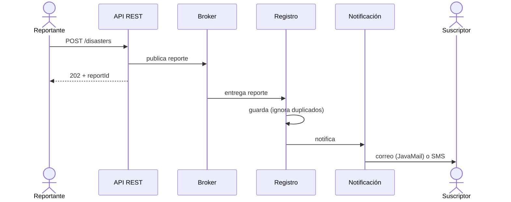

# Contexto y flujo

## Requerimiento

El sistema de gestión de emergencias y desastres debe recibir de forma asíncrona la información de un desastre, registrarla y notificar a los sistemas o personas registradas por correo electrónico o SMS. La recepción y la notificación pasan por un broker de mensajería.

## Flujo común

La API responde antes de que el reporte se registre. Quien reporta no espera al registro ni al envío de notificaciones.

## Modelo

- Reporte de desastre: `reportId`, `type`, `location`, `severity`, `description`, `reportedAt`.
- Suscriptor: `name`, `channel` (EMAIL o SMS), `contact`.

El `reportId` lo genera la API al recibir el reporte y sirve como clave de idempotencia.

## Canales de notificación

- Correo: JavaMail contra un servidor SMTP. En el taller es MailHog, que guarda los correos y los muestra en una web.
- SMS: simulado. Se escribe una línea en el log. Cambiarlo por un proveedor real implica reemplazar una sola clase.

## Entrega y duplicados

Los brokers entregan al menos una vez. Si un mensaje se reentrega, el registro lo detecta por `reportId` y no lo guarda ni lo notifica de nuevo. En las variantes con topic o con eventos posteriores al registro (servicios y microservicios), una caída entre el guardado y la publicación del evento puede perder una notificación. Se acepta para el taller. Para cerrarlo haría falta un outbox.
