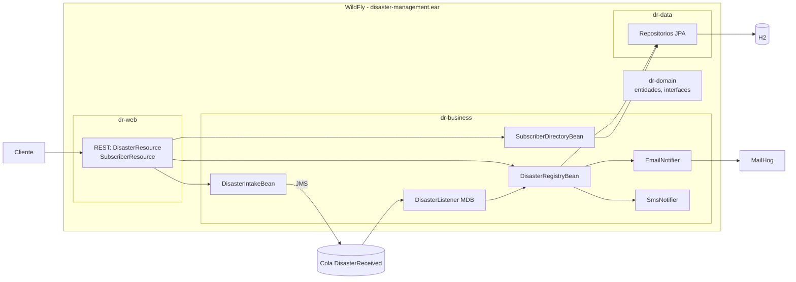

# Variante tiers

Una sola aplicación (EAR) con tres capas que solo se llaman hacia abajo. Corre en un contenedor WildFly.

## Módulos

- `dr-domain`: entidades, mensaje, interfaces de servicios y repositorios. Lo usan todas las capas.
- `dr-data`: repositorios JPA. No conoce la capa de negocio.
- `dr-business`: EJB de intake, registro y suscriptores, el MDB y los notificadores.
- `dr-web`: recursos REST. Solo hablan con las interfaces del dominio.
- `dr-ear`: empaqueta todo. Las librerías compartidas van en `lib/`.

## Mensajería

La cola `DisasterReceived` vive en el Artemis embebido de WildFly (`standalone-full.xml`) y se crea en `docker/wildfly/configurar.cli`. El MDB procesa cada mensaje dentro de una transacción. Si el registro falla, el mensaje se reentrega.
