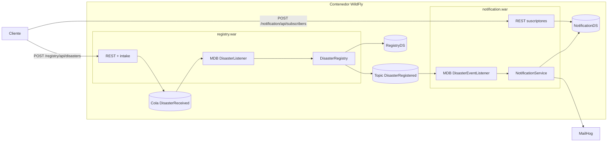

# Variante servicios

Dos servicios con responsabilidades separadas, desplegados como WAR independientes en el mismo contenedor WildFly. No comparten código ni base de datos. Se hablan solo por mensajes.

## Contrato entre servicios

El topic `DisasterRegistered` transporta un JSON con `reportId`, `type`, `location`, `severity` y `description`. Cada servicio define su propia clase para ese JSON. Si registry agrega campos, notification los ignora.

## Mensajería

- Cola `DisasterReceived`: un solo consumidor (el registro).
- Topic `DisasterRegistered`: el MDB de notification usa suscripción durable. Los eventos publicados mientras el servicio está caído se entregan al volver.
