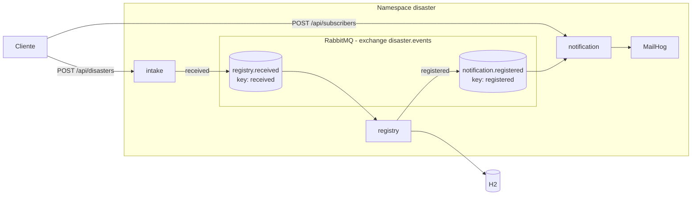

# Variante microservicios

Tres servicios Quarkus, cada uno en su contenedor y con su ciclo de despliegue. La mensajería es RabbitMQ. Se orquestan en Kubernetes.

## Servicios

| Servicio | Responsabilidad | Estado |
|---|---|---|
| intake | Valida el reporte y lo publica. | Sin estado. |
| registry | Consume, guarda y publica el evento de registrado. Expone la consulta. | H2 en memoria. |
| notification | Guarda suscriptores y notifica por correo o SMS. | Lista en memoria. |

## RabbitMQ

Un exchange `topic` (`disaster.events`) con dos claves de enrutamiento. Cada consumidor declara su cola al arrancar. Si intake publica antes de que exista la cola de registry, el mensaje se descarta. Docker Compose y los readiness probes de Kubernetes reducen esa ventana, pero no la eliminan. Una solución completa es precargar las colas con un archivo de definiciones de RabbitMQ.

## Kubernetes

Cada servicio tiene un Deployment con una réplica y un Service NodePort. La configuración común (hosts de RabbitMQ y SMTP) está en un ConfigMap. Los probes de readiness usan `/q/health/ready`.

Notification guarda los suscriptores en memoria, por eso corre con una sola réplica. Escalarlo exige moverlos a una base de datos compartida.
